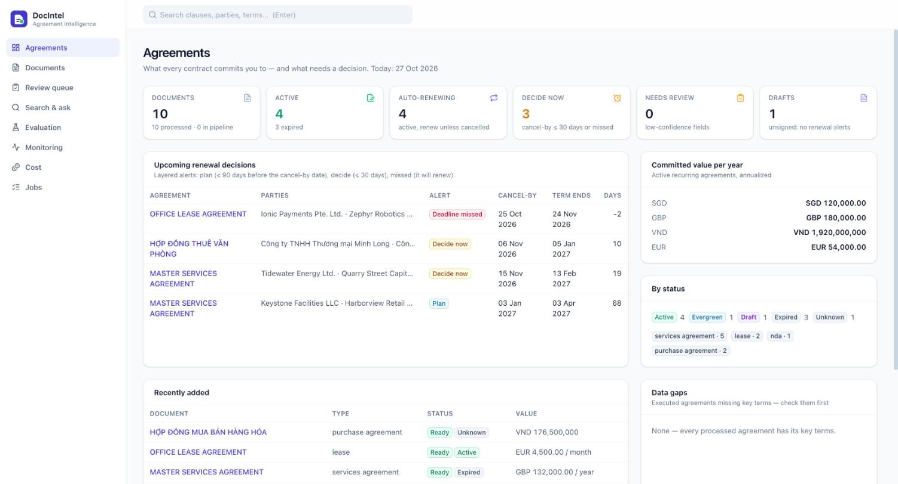
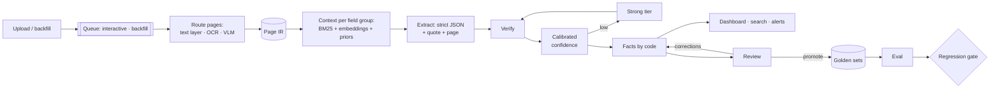

# DocIntel — agreement intelligence

**Turn every contract into verified, structured data: who signed, what it is worth, when it
expires, what can be cancelled — with the evidence for every value, a measured accuracy,
and a known cost per document.**


Most document-AI demos read one clean PDF. Real corpora hold 120-page agreements whose
renewal clause sits on page 87, scans with a red company seal over the signature,
amendments that override the original term, struck-through redlines that are still in the
text layer, price tables, and more than one language. DocIntel is an end-to-end pipeline,
API and UI built around three questions:

1. **Is it right?** Every value carries a verbatim quote and page, is checked against the
   page, gets a calibrated confidence, and goes to human review when unsure. A golden set
   and a paired regression gate decide whether any change ships.
2. **What does it cost?** Every model call is metered; quality per dollar is a chart, the
   whole-corpus cost is a formula over measured inputs, and so is the break-even of
   running our own model.
3. **Will it keep working?** Live quality proxies, human corrections as labels, input and
   output drift (PSI), and a canary that catches the model changing behind its name.



## What it does

| | |
|---|---|
| **Parsing with per-page routing** | text layer (free, exact) · local OCR (RapidOCR, English) · vision-language model for what OCR gets wrong — each decision recorded with its reason |
| **Layout that matters for contracts** | struck-through text removed, drawn signatures and seals detected as `[signed]` / `[stamp]`, two-column signature blocks read column by column, tables kept as rows, page furniture dropped |
| **Evidence-first extraction** | strict JSON schema (four field groups), a quote + page per value, null as a first-class answer, validate-and-repair loop |
| **Long documents** | short ones in one call; long ones per field group with hybrid retrieval (BM25 + multilingual embeddings) plus structural priors (first page, signature blocks, amendments, definitions, fee tables) under a token budget |
| **Verification** | quote grounding (tolerant of OCR noise and layout breaks), value-in-quote checks, business rules (line items vs total, term before start, unsigned blocks) |
| **Calibrated confidence + cascade** | isotonic calibration fitted on the dev split; low-confidence groups re-run on the strong tier with a wider context; the better-verified answer wins |
| **Facts derived by code** | term end, current term, cancel-by date, status, layered renewal alerts (plan / decide / missed) — never computed by the model |
| **Review loop** | review queue, approve/correct per field with the evidence highlighted in the PDF; corrections re-derive facts and are the production accuracy signal; reviewed documents become golden data |
| **Evaluation** | synthetic golden set with exact labels and evidence pages, real contracts from CUAD, field-level metrics with Wilson CIs, slices, calibration, evidence recall, OCR fidelity; regression gate with McNemar + paired bootstrap |
| **Monitoring** | correction / review / grounding / null rates per field, cost, latency, LLM errors, prompt-cache share, route mix, PSI drift, canary |
| **Cost** | quality-per-dollar frontier across configurations, corpus projection from measured statistics, self-hosting break-even |
| **Operations** | DB-backed queue with interactive and backfill lanes, leases, backoff, dead letter, idempotency; content-addressed dedup; every artifact versioned and cached |
| **Search & ask** | hybrid retrieval over section-aware chunks, filtered by extracted facts ("auto-renewing, cancel-by in 30 days"), answers with page citations whose quotes are verified |

## How it works



Details: [architecture](docs/architecture.md) · [evaluation & annotation guideline](docs/evaluation.md) ·
[cost model](docs/cost.md) · [security](docs/security.md).

## Results

Measured with a GPT-class reasoning model behind an OpenAI-compatible gateway, on the golden
sets in this repository. Costs use the placeholder price table ($1.25 / $0.125 / $10 per 1M
input / cached / output tokens) — set your own prices on the Cost page.

<!-- RESULTS:START -->
*(filled by the final evaluation runs)*
<!-- RESULTS:END -->

### Findings that shaped the pipeline

* **OCR confidence lies.** The recognizer bundled with RapidOCR is the Chinese PP-OCR
  model: on English scans it drops every space (`ThisMutualNon-DisclosureAgreement`) at
  **0.97 confidence**; on Vietnamese it drops every diacritic, also above 0.9. Routing
  therefore combines confidence with language identification (including de-accented
  Vietnamese) and word-length plausibility, and the English PP-OCRv3 recognizer is used
  for English.
* **A helper model can be the bug.** The 180° text-line classifier flipped long justified
  lines of slightly rotated scans and the recognizer read them upside down (23 of 51 lines
  on one page). Disabling it took page confidence from 0.60 to 0.97 and English scans from
  VLM back to local OCR; unreadable lines now count in page confidence.
* **Layout breaks grounding.** Side-by-side signature blocks read row by row interleave
  the parties ("Lê Hoàng Minh Võ Ngọc Lan"); the model quotes column by column, the quote
  no longer matches the page, confidence drops and the group escalates — on 9 of 20
  documents. Reading signature blocks column by column, and checking multi-line quotes
  segment by segment, removed every one of those escalations.
* **Routing per document beats a fixed strategy on cost.** Retrieval for every document
  costs more than one full-document call for short documents (four calls, four schema
  prefixes); sending long documents whole costs ~2× more than retrieving their pages, at
  equal accuracy on this set.

## Quickstart

Requirements: [uv](https://docs.astral.sh/uv/) (Python 3.12 is installed by uv), Node.js ≥ 20.

```bash
git clone https://github.com/nguyenquyking/docintel.git && cd docintel
make setup                 # backend + frontend dependencies, git hooks (secret scanning)
cp .env.example .env       # optional: configure a model provider (see below)
make serve                 # builds the UI, serves UI + API + worker on http://127.0.0.1:8077
```

Without a `.env` the app runs offline with the `fake` model (valid but empty answers) —
enough to explore the UI, the queue and the evaluation machinery. Then:

```bash
make demo                  # 10 sample contracts, some with cancel-by dates in the coming weeks
make golden                # synthetic golden set (60 contracts) + canary subset
make cuad                  # 25 real contracts from CUAD with expert labels (~100 MB download)
make eval PRESET=cascade SPLIT=test
make gate BASE=<run-id> CAND=<run-id>      # exit code 1 on regression — use it in CI
```

For UI development: `make dev` (API on :8077, Vite on :5177 with hot reload).

### Model providers

Any OpenAI-compatible chat endpoint. Tiers (`fast`, `strong`, `vision`) can point at the
same model with different reasoning effort.

```bash
# Databricks AI Gateway — personal CLI login for development
databricks auth login --profile my-profile
DOCINTEL_LLM_PROVIDER=databricks
DOCINTEL_DATABRICKS_PROFILE=my-profile
DOCINTEL_LLM_MODEL_FAST=<gateway route or endpoint name>
DOCINTEL_LLM_MODEL_STRONG=<same or another>

# OpenAI, vLLM, Ollama…
DOCINTEL_LLM_PROVIDER=openai
DOCINTEL_LLM_BASE_URL=https://api.openai.com/v1      # or http://localhost:8000/v1 (vLLM)
DOCINTEL_LLM_API_KEY=...
DOCINTEL_LLM_MODEL_FAST=...
```

Containers use a service principal (`DOCINTEL_DATABRICKS_CLIENT_ID` / `_SECRET`) or an API
key: `docker compose up` runs Postgres, the API and a separate worker. Every setting is
documented in [`.env.example`](.env.example).

## Repository layout

```
backend/docintel/
  parsing/      PDF text layer, layout, OCR engines, VLM transcription, page routing, IR
  retrieval/    chunking, BM25, embeddings, hybrid page selection
  extraction/   schema, prompts, extractor (modes, repair, cascade), verification, confidence, facts
  llm/          OpenAI-compatible client, Databricks auth, rate limiting, pricing
  queue/        job queue and worker            pipeline/  per-document orchestration
  eval/         metrics, statistics, golden sets, runner, regression gate
  monitoring/   live metrics, drift, canary     cost/      projection, break-even, Pareto
  synth/        synthetic contract generator    datasets/  CUAD importer
  search/       hybrid search and cited Q&A     api/       FastAPI routers
frontend/src/   React + TypeScript UI (pages/, components/)
scripts/        secret scanner, git hook installer
docs/           architecture, evaluation, cost, security
```

## Development

```bash
make test        # 49 backend tests: parsing on generated PDFs, queue semantics, LLM client
                 # (retries, cache, metering), an oracle model running the whole pipeline
                 # offline, eval + gate, API, secret scanner
make lint typecheck
make scan        # secret scan of tracked files and the full history
```

CI runs the secret scan (plus gitleaks), the backend tests on SQLite and Postgres, the
frontend build and the Docker build.

## Limitations

* Single tenant, no authentication: put it behind your SSO proxy before exposing it.
* Page orientation is not corrected (upside-down scans go to the VLM via low OCR confidence).
* The synthetic set is easier than real traffic — all configurations score 100 % on it;
  real contracts (CUAD, reviewed documents) are where configurations separate. CUAD
  labels are mapped from its answers and cover a subset of fields.
* SQLite is the default; Postgres is supported (and tested in CI) for multiple workers.

## Credits

CUAD v1 — The Atticus Project, CC BY 4.0. PaddleOCR models (Apache-2.0) via RapidOCR /
RapidAI ONNX conversions. Multilingual embeddings: `paraphrase-multilingual-MiniLM-L12-v2`
(Apache-2.0) via fastembed. PDF handling: pdfplumber (MIT), pypdfium2 (Apache-2.0 /
BSD-3), reportlab (BSD).

## License

MIT — see [LICENSE](LICENSE).
