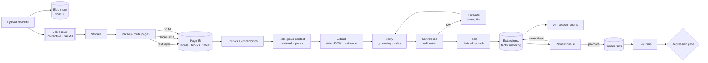

# Architecture

## Pipeline stages

| Stage | Module | What it does | Cached by |
|---|---|---|---|
| ingest | `services.ingest` | content-addressed blob, document row, idempotent job | sha256 |
| parse | `parsing/parser.py` | per-page route: text layer / local OCR / VLM; struck-through text removed; tables; signature and seal marks; reading order; page furniture dropped | (sha256, parser version) |
| index | `retrieval/chunking.py`, `embeddings.py` | section-aware chunks with page ranges; multilingual embeddings | per document |
| select | `retrieval/hybrid.py` | per field group: BM25 + embeddings (RRF) + structural priors under a token budget | — |
| extract | `extraction/extractor.py` | strict JSON schema per group, validate-and-repair loop | exact request (LLM cache) |
| verify | `extraction/verify.py` | quote grounding, value-in-quote, business rules | — |
| score | `extraction/confidence.py` | heuristic → isotonic calibration; review threshold | — |
| escalate | `extraction/extractor.py` | weak critical groups → strong tier, wider context; better-verified answer wins | — |
| derive | `extraction/derive.py` | term end, cancel-by date, current term, status, layered alerts | — |
| persist | `pipeline/runner.py` | extraction with provenance; facts = extraction + corrections | pipeline key |

A document whose bytes were already processed with the same pipeline key (pipeline,
parser, schema and prompt versions, configuration, models) reuses that extraction with no
model call.

## Page routing

| Situation | Route | Why |
|---|---|---|
| text layer with ≥ 40 characters and quality ≥ 0.9 | text layer | exact, free, word boxes |
| scan, English, OCR plausible and confident, no table | local OCR (RapidOCR, PP-OCRv3 English) | cheap, word boxes for highlighting |
| scan in a language the OCR model lacks (Vietnamese) | VLM | the OCR returns text **without diacritics at 0.9+ confidence** |
| OCR text implausible (run-on tokens: lost spaces) | VLM | confidence does not show it |
| OCR confidence < 0.85 (unreadable lines included) | VLM | |
| table on a scanned page | VLM | cell structure matters more than characters |

Three findings from the first live runs shaped this table: the bundled Chinese PP-OCR
recognizer drops spaces in English (fixed with the English recognizer); the 180° line
classifier flips long justified lines (disabled; unreadable lines now lower page
confidence); and confidence alone never revealed either problem.

## Extraction schema

Four field groups (`extraction/schema.py`) — parties & signatures, term & renewal &
termination, commercial, document type & governing law. Every value has a verbatim quote
and a page. In **full-document mode** (documents up to `DOCINTEL_FULL_DOC_MAX_TOKENS`) one
call extracts everything; in **grouped mode** each group gets its own pages. Both modes
can be compared on the golden set (`long-context` and `retrieval-only` presets).

## Job queue

`queue/jobs.py`: one table, two lanes, leases with heartbeat, exponential backoff with
jitter, dead letter, idempotency keys. Claiming is one atomic `UPDATE … RETURNING`
(`FOR UPDATE SKIP LOCKED` on Postgres). Interactive jobs go first; every fourth claim
prefers backfill so a corpus re-run never starves and never blocks a user upload.
Transient failures (429, 5xx, timeouts, an expired login) retry; unreadable files and
malformed requests go straight to the dead letter.

## Model access

`llm/client.py` speaks OpenAI-compatible chat completions to Databricks AI Gateway,
OpenAI, or a self-hosted server (vLLM, Ollama) — "vendor vs own model" is a configuration
change. It rate-limits requests and tokens per minute, retries only what heals, keeps
provider error bodies verbatim, caches exact requests, never sends `temperature` by
default, and meters every call (prompt, cached, completion and reasoning tokens; latency;
cost by tier).

## Data model

`models.py`: blobs, documents, pages, chunks, extractions (with fields, facts, selected
pages, warnings, versions, cost), field reviews, jobs, LLM calls, LLM cache, golden sets
and documents, eval runs, eval documents and items, settings (price table, calibration).

## Operations

* **Scale out** by running more `python -m docintel worker` processes against Postgres;
  the client-side RPM/TPM limits are per process — divide the provider quota.
* **Re-processing** after a parser, schema or prompt change is automatic: bump the
  version, re-enqueue on the backfill lane; unchanged requests are served from the cache.
* **Canary**: set `DOCINTEL_CANARY_INTERVAL_HOURS` and build the canary set; a quality
  drop with no code change means the model behind the endpoint changed.
* **Dead letter**: the Jobs page shows the error; requeue after fixing the cause.
